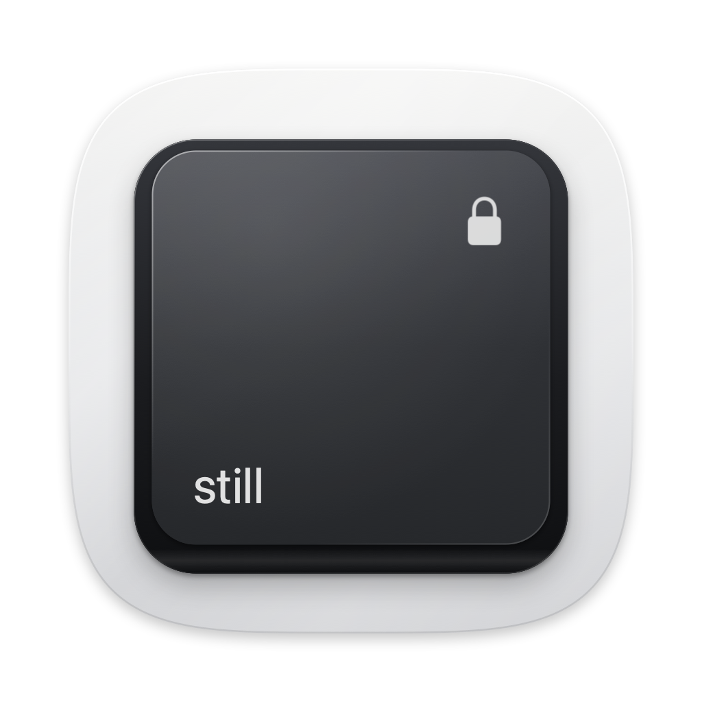
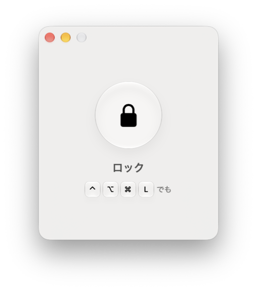
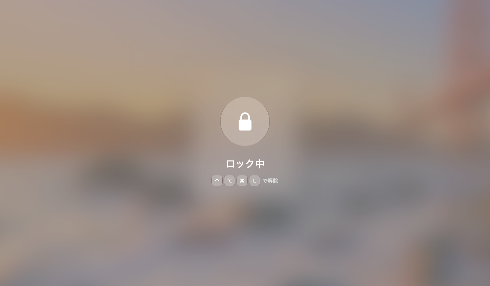

<p align="center"></p>

# Still

キーボード、トラックパッド、タッチスクリーンを、拭いている間だけ止める macOS アプリ。

開いて鍵を押す（または ⌃⌥⌘L）とロックされ、画面に「ロック中」が出ます。もう一度 ⌃⌥⌘L で解除します。時間制限はありません。

<p align="center">
  
</p>

<p align="center">
  
</p>

## 動作環境

- macOS 26 以降（Liquid Glass を使うため）
- Apple Silicon

## ビルドとインストール

Xcode は不要です。Command Line Tools の `swiftc` だけでビルドできます。

```sh
./build.sh           # build/Still.app を作る
./build.sh install   # /Applications に入れて起動する
```

初回は「システム設定 → プライバシーとセキュリティ → アクセシビリティ」で Still をオンにしてください。

> アドホック署名のため、ビルドし直すと macOS は別のアプリとして扱います。
> 入れ直したあとは、一覧から Still を一度削除して許可し直してください。

## 仕組み

| ファイル | 役割 |
| --- | --- |
| `Sources/InputBlocker.swift` | HID とセッションの2か所のイベントタップで、すべての種類の入力を捨てる。専用スレッドで動かすので、描画で詰まってもタップが外れない |
| `Sources/Locker.swift` | ロック状態、権限、全画面のオーバーレイ。オーバーレイは、すり抜けたクリックやタッチも受け止める |
| `Sources/Views.swift` | メインウィンドウとロック中の表示 |
| `Sources/App.swift` | アプリの入口と ⌃⌥⌘L のグローバルホットキー |
| `tools/make-icon.swift` | アイコンをコードで描き、各サイズを直接書き出す |

ロックを解除するたびに `~/Library/Logs/Still.log` に1行書きます。`ok: no leaks` なら、ロック中の入力はすべて止まっています。`LEAK: …` なら、どの入力がすり抜けたかが分かります。

## 止められないもの

- 電源ボタン（Touch ID）

## アイコン

Mac の修飾キーの「右上に記号・左下に名前」の印字を借りて、右上に鍵、左下に `still` と印字したキーにしています。寸法は黄金比で揃えています（キー幅 = 全体 / φ、キー側面の厚み = 1 : φ : φ²）。
